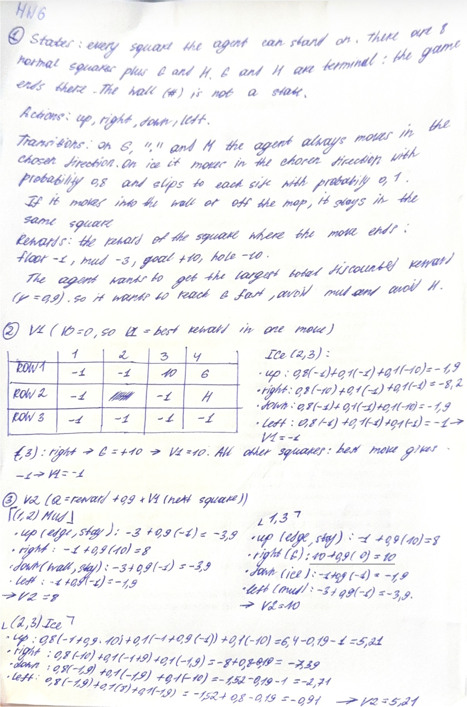
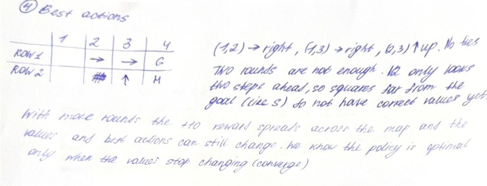

# HW6 submission

## AI-use declaration

Which tools did you use, and for what?

I used Claude (Anthropic) to explain and check the Part A calculations, to help write the Python code for Part B (`part_b_frozenlake.py`) and Part C (`part_c_solver.py`), and to help structure this file. I wrote Part A by hand, ran all programs myself in GitHub Codespaces, and all numbers below come from my own runs.

## Setup and reproduction

Record dependency versions, installation commands and exact run commands.

Versions (from `outputs/versions.txt`): Python `3.14.2`, gymnasium `1.4.0`, numpy `2.5.5`.

```bash
python3 -m venv .venv
source .venv/bin/activate
pip install -r requirements.txt
python part_c_solver.py
python part_b_frozenlake.py
pip freeze > outputs/versions.txt
python --version >> outputs/versions.txt
```

## Part A — Paper calculations

Link your scan/photo here. Include V1 for every nonterminal tile, the three requested V2 calculations, best-action arrows/ties and your explanation. Commit this part before coding.




- **V1:** −1 on every nonterminal tile except (1,3), where V1 = 10 (move right into G).
- **V2:** (1,2) = 8 (right), (1,3) = 10 (right), (2,3) ice = 0.8·8 + 0.1·(−1.9) + 0.1·(−10) = 5.21 (up).
- **Best actions:** (1,2) →, (1,3) →, (2,3) ↑. No ties.
- Two rounds do not prove the final optimal policy: V2 only looks two steps ahead, so values far from the goal are not correct yet and can still change in later rounds.

## Part B — FrozenLake

### Fixed policy, written before the experiments

State the action for each nonterminal state and your reasoning.

States are numbered `row*4 + col` (0 = S, 15 = G; holes are 5, 7, 11, 12).

| State | 0 | 1 | 2 | 3 | 4 | 6 | 8 | 9 | 10 | 13 | 14 |
| --- | --- | --- | --- | --- | --- | --- | --- | --- | --- | --- | --- |
| Action | Down | Left | Down | Left | Down | Down | Right | Down | Down | Right | Right |

Reasoning: the shortest safe path is 0 → 4 → 8 → 9 → 13 → 14 → 15. With deterministic moves it never enters a hole. States off this path (1, 2, 3, 6, 10) send the agent back to the path or down towards 14.

### Results

| Slippery? | Policy | Batch seed | Goals /50 | Holes /50 | Time limits /50 | Success % | Mean steps |
| --- | --- | --- | --- | --- | --- | --- | --- |
| False | random | 11 | 2 | 48 | 0 | 4% | 9.78 |
| False | random | 22 | 0 | 50 | 0 | 0% | 6.90 |
| False | random | 33 | 0 | 50 | 0 | 0% | 7.44 |
| False | fixed | 11 | 50 | 0 | 0 | 100% | 6.00 |
| False | fixed | 22 | 50 | 0 | 0 | 100% | 6.00 |
| False | fixed | 33 | 50 | 0 | 0 | 100% | 6.00 |
| True | random | 11 | 0 | 50 | 0 | 0% | 8.44 |
| True | random | 22 | 1 | 49 | 0 | 2% | 7.76 |
| True | random | 33 | 0 | 50 | 0 | 0% | 7.30 |
| True | fixed | 11 | 1 | 49 | 0 | 2% | 5.22 |
| True | fixed | 22 | 2 | 48 | 0 | 4% | 6.00 |
| True | fixed | 33 | 1 | 49 | 0 | 2% | 5.14 |

Link episode rows and example traces in outputs/. Explain slipping, variation across batches and why these runs do not train a policy.

Files: [episode rows](outputs/part_b_episodes.csv), [summary](outputs/part_b_summary.md), [success/failure traces](outputs/part_b_traces.txt), [rendered episode](outputs/part_b_example_episode.txt).

- **Slipping:** without slipping, my fixed policy reached the goal in all 150 episodes in exactly 6 steps. With `is_slippery=True` it reached the goal in only 4 of 150 episodes (2–4% per batch). In slippery FrozenLake the chosen move happens only with probability 1/3; otherwise the agent moves to one of the two perpendicular sides. My path goes right next to holes (for example, Down from state 4 can slip right into hole 5, and Right from state 8 can slip down into hole 12), so most episodes end in a hole after about 5 steps. With slipping, the fixed policy was not much better than random actions (1 of 150 goals). No episode reached the 100-step limit in any condition.
- **Variation across batches:** the non-slippery fixed policy gave the same result in every batch (50/50 goals, 6 steps), because both the policy and the environment are deterministic. In the random conditions, goals per batch went from 0 to 2, and for the slippery fixed policy from 1 to 2. These counts are very small, so a difference of 1–2 goals between batches is just chance; 50 episodes give only a rough estimate of the success rate.
- **Traces:** `outputs/part_b_traces.txt` has one successful and one failed trace for each condition where they happened. A failed episode never happened for the non-slippery fixed policy (it always reached the goal); the file says this.
- **One success is not enough:** with slipping, the result of one episode is random. One goal can be luck. Only the success rate over many seeded episodes shows how good a policy is.
- **Not training:** both policies stay fixed. The agent never changes its actions using the rewards; we only measure how well a given policy works.

## Part C — Custom solver

### Compare code with paper

Show V1 and the requested V2 values. Explain discrepancies.

From [outputs/part_c_report.txt](outputs/part_c_report.txt):

```
V1:
  -1.000.   -1.000M   10.000.    0.000G
  -1.000.    ####     -1.000I    0.000H
  -1.000S   -1.000.   -1.000.   -1.000.

(1,2) M: up=-3.900, right=8.000, down=-3.900, left=-1.900 -> V2=8.000, best=['right']
(1,3) .: up=8.000, right=10.000, down=-1.900, left=-3.900 -> V2=10.000, best=['right']
(2,3) I: up=5.210, right=-7.390, down=-2.710, left=-0.910 -> V2=5.210, best=['up']
```

The program gives exactly the same V1 and V2 values as my paper calculations. There are no discrepancies.

### Values, policies and convergence

Link both value/policy maps. Record iteration counts, final value changes and tie-breaking rule.

Both maps are in [outputs/part_c_report.txt](outputs/part_c_report.txt).

Tie-breaking rule: if several actions have the same best value (difference below 1e-9), the first one in the order up, right, down, left is chosen. No ties happened in the final policies.

Paper map: converged after **12 iterations**, final max change **2.165e-07**.
```
Values:                              Policy:
   4.200.    8.000M   10.000.    G   > > > G
   2.780.    ####      5.824I    H   ^ # ^ H
   1.536S    2.818.    4.242.    2.818.   > > ^ <
```

Extended map: converged after **11 iterations**, final max change **2.406e-07**.
```
Values:                              Policy:
   4.200.    8.000M   10.000.    G   > > > G
   2.780.    ####      5.824I    H   ^ # ^ H
   1.502S    2.818D    4.242.    2.818W   ^ > ^ <
```

### Simulation results

| Map | Batch seed | Goals /50 | Holes /50 | Time limits /50 | Mean steps | Mean discounted return |
| --- | --- | --- | --- | --- | --- | --- |
| paper | 11 | 42 | 8 | 0 | 4.98 | 0.891 |
| paper | 22 | 46 | 4 | 0 | 5.04 | 1.915 |
| paper | 33 | 48 | 2 | 0 | 5.04 | 2.492 |
| extended | 11 | 50 | 0 | 0 | 5.00 | 1.502 |
| extended | 22 | 50 | 0 | 0 | 5.00 | 1.502 |
| extended | 33 | 50 | 0 | 0 | 5.00 | 1.502 |

Episode rows: [outputs/part_c_episodes.csv](outputs/part_c_episodes.csv).

### Explain your results

Which values/actions changed with sand and water? Where did cost and risk matter? How do simulations relate to the computed values?

- **What changed:** only the start S. On the paper map, S goes right along the bottom row and then up through the ice (value 1.536). On the extended map, entering sand costs −2, so going right is worse (−2 + 0.9·2.818 = 0.536). S now goes up the left column and through the mud (1.502). All other values and actions stay the same, because no other best route uses sand or water.
- **Water:** the policy never enters W, so its −5 cost does not change any value.
- **Cost and risk (ice):** on the paper map the route through the ice is a little better on average, but from the ice there is a 10% chance to slip into the hole. This is why 14 of 150 episodes ended in H. On the extended map the policy avoids the ice, so all 150 episodes reach G.
- **Simulations vs values:** V(S) is the expected discounted return over an infinite horizon. A simulation uses only 50 episodes and stops after 100 steps, so the batch means are random and scatter around V(S) (paper map: 0.891, 1.915, 2.492 around 1.536). On the extended map every move is deterministic, so every episode is the same and the mean is exactly V(S) = 1.502. The 100-step limit does not matter here, because all episodes end after about 5 steps.

### Rule checks

Show boundary/wall behavior, slip probabilities, floor rewards and terminal handling.

All checks pass (see the `RULE CHECKS` section of [outputs/part_c_report.txt](outputs/part_c_report.txt)):

- **Boundary/wall:** moving off the map or into the wall keeps the agent in place and still gives the reward of that tile (for example, down from mud into the wall = −3). The wall is not a state.
- **Slip probabilities:** for every action on ice, the probabilities 0.8 + 0.1 + 0.1 sum to 1. This holds for all states and actions.
- **Floor rewards:** mud −3, sand −2, water −5, goal +10, hole −10. Sand and water are deterministic.
- **Terminal handling:** G and H have no transitions and no further rewards, and their values stay 0.